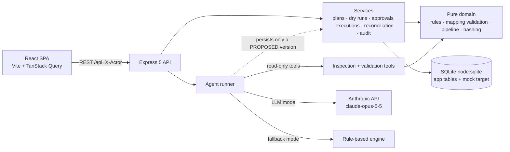

# Agentic Data Migration Planner & Reconciliation Workbench

Plan, validate, execute, reconcile and roll back the migration of **one bounded dataset** — a 150-record sample of a legacy customer export (`legacy_customers`) into a new schema (`customers`) held in a **mock staging store**.

An **AI agent proposes** the field mappings, risks, questions and migration plan using read-only inspection tools. A **human reviews and approves**. Everything that touches data afterwards (dry run, quarantine, execution, retry, rollback, reconciliation) is **deterministic, idempotent and recorded in an append-only history**.

> **Hosted deployment:** _add your URL here after deploying (see [Deployment](#deployment))._
> No login is needed. Reviewers: open the URL → **Mapping plan → Propose a mapping plan** and follow the [walkthrough](#reviewer-walkthrough-5-minutes).

---

## Contents
1. [Quick start](#quick-start) · 2. [Reviewer walkthrough](#reviewer-walkthrough-5-minutes) · 3. [Scope](#scope) · 4. [Architecture](#architecture) · 5. [Requirements → implementation](#requirements--implementation) · 6. [The AI agent](#the-ai-agent) · 7. [Dataset & expected results](#dataset--expected-results) · 8. [Tests](#tests) · 9. [Logging](#logging) · 10. [Configuration](#configuration) · 11. [API](#api) · 12. [Deployment](#deployment) · 13. [Limitations](#limitations--known-gaps)

---

## Quick start

Requires **Node ≥ 22.13** (uses the built-in `node:sqlite`; no native modules to compile).

```bash
npm install
npm run dev          # API on :8080, UI on http://localhost:5173 (proxied)
```

Production-style (one process serves API + UI on :8080):

```bash
npm run build && npm start
```

Docker: `docker build -t migration-workbench . && docker run -p 8080:8080 -e ANTHROPIC_API_KEY=... migration-workbench`

**With or without an API key.** Set `ANTHROPIC_API_KEY` to use the Claude agent. Without it the app is still fully usable: proposals come from a deterministic **rule-based fallback engine** that goes through the *same tools and the same review gate*. The UI labels which engine produced every plan ("Agent: claude-opus-5-5" vs "rule-based fallback (no LLM)") — the fallback is never presented as AI.

Commands: `npm test` (119 server tests) · `npm run typecheck` · `npm run generate:data` (regenerates the sample, deterministic) · `ANTHROPIC_API_KEY=… npm run agent:smoke` (live check of the LLM path, see [Tests](#tests)).

---

## Reviewer walkthrough (5 minutes)

| # | Do this | What to look for |
|---|---|---|
| 1 | **Mapping plan → Propose a mapping plan** | Live agent trace (every tool call + timing). Result is a *proposed* **v1**: mapping table with risk per field, risks, missing fields, 6 clarification questions, migration plan. |
| 2 | Open the **Questions** tab; *Accept* the proposed assumptions (or type your own) | 3 are *blocking*: `currency` (no such field in source), `tier` (business mapping), `marketing_opt_in` (blank consent). Try approving first — it is refused. |
| 3 | **Run dry run on v1** | `150 source → 130 transformed → 101 accepted / 49 rejected`. Click an error code (e.g. `INVALID_PHONE`) and expand a row: source value, rule, code, reason, source vs transformed side-by-side. |
| 4 | **Edit as new version** (optional) | Change `currency` to `USD`; live validation as you type; saves **v2** with a diff against v1. v1 is untouched. Run a dry run on v2. |
| 5 | **Approve & execute → Approve** | Approval is bound to *this version + this dry run + this source data*. |
| 6 | Tick **“make the target fail after 40 records”**, then **Execute** | Execution fails part-way: 25 rows committed (one whole batch), 79 still pending; the failing batch rolled back as a unit. |
| 7 | **Retry** | Completes. “Duplicates prevented: 25” — the already-loaded rows were re-presented and blocked by the unique key. Attempts table shows both attempts. Click **Retry (idempotency check)** once more: 101 more duplicates prevented, 0 inserted. |
| 8 | Read **Reconciliation** | Source 150 = migrated 101 + quarantined 49; target 5 → 106; control total of balances matches. |
| 9 | **Roll back…** (reason required) | 101 rows removed; the 5 pre-existing rows untouched; target back to baseline. |
| 10 | **History** | Approval, execution, failure, retry, completion, rollback — who/when. The agent run is replayable under *Agent runs*. |

---

## Scope

### Completed
- **Versioned plans** — immutable numbered versions (DB trigger refuses in-place edits), parent links, diff between versions, notes, who/when.
- **AI agent** (Claude via the Anthropic SDK, manual tool-use loop) that proposes mappings, identifies incompatible/missing fields, suggests supported transformations, explains risks, asks clarification questions and prepares a migration plan — using **only** inspection/validation tools. A deterministic rule-based fallback uses the same tools and gate.
- **Human approval gate** — approval needs: structurally valid mapping, a *current* dry run on that exact version, all blocking questions answered, explicit confirmation. Execution re-verifies everything.
- **Deterministic dry run** — pure function of (source, mapping, schema); a hash proves it. Nothing is written.
- **Quarantine with field-level evidence** — every rejected record keeps, per failing field: stage, rule, code, source value, transformed value, message (and for duplicates/conflicts, *which* record/row it collided with).
- **Counts** — source / transformed / accepted / rejected (+ loaded, skipped, pending, duplicates prevented) on dry run, execution and overview.
- **Execution into the mock target** — batched, transactional per batch; target constraints enforced again by the store itself.
- **Retry without duplicates** — deterministic target key + `UNIQUE(source_key)`; the retry re-presents *every* accepted record and the guard, not bookkeeping, prevents duplicates. Idempotency keys for the request itself.
- **Reconciliation** — 7 independent checks incl. a control total; detects deleted rows and corrupted values (tested).
- **Rollback** — removes only the execution’s rows, records reason/actor/rows removed, restores baseline, allows a fresh run.
- **History** — approvals, executions, failures, retries, rollbacks, agent runs in an append-only table (update/delete rejected by triggers).
- **UX states** — loading, empty, validation (live in the editor), success toasts, failure banners with codes and blockers, confirm dialogs for approve/execute/rollback.
- **Structured logs** (pino JSON) incl. per-tool-call agent logs; **119 tests**; Dockerfile + Render blueprint.

### Intentionally excluded (per the brief)
Production databases, arbitrary/user-supplied transformation code, distributed/parallel migration, live cloud connectors, multiple sources/targets. The sample is **bounded to a documented maximum of 500 records** (`MAX_SAMPLE_SIZE`; the server refuses to start with more; shipped sample = 150).

### Not built (judgement calls)
Authentication/authorisation (reviewer name is attribution only), data upload, multi-user concurrency control, streaming agent tokens, frontend unit tests (the UI is covered by a scripted browser walkthrough, `e2e/run.mjs`).

---

## Architecture



```
server/src
  domain/    types · rules (closed registry of 16 deterministic rules) · mapping (structural validation) · pipeline · hash
  services/  plans · clarifications · dryRuns · approvals · executions · reconciliation · audit · targetStore · sourceStore
  agent/     tools (9) · prompts · llm (SDK boundary) · runner (loop, trace, persistence) · heuristic (offline engine)
  routes/    data · plans · runs · helpers (errors, actor)      db/ connection · schema (DDL, generated target table) · seed
web/src      pages (Overview · Data · Plan · DryRun · Execute · History) · components (Mapping view/editor · RecordsTable · AgentTrace)
data/        source-schema · target-schema · sample-source-records (150) · target-seed (5) · sample-manifest (expected defects)
```

**Plan version lifecycle:** `proposed` (agent) or `draft` (human edit) → `approved` | `rejected`. Mapping, hash and analysis are immutable; only the review status changes.
**Execution lifecycle:** `running → completed | failed`, `failed|completed → (retry) running`, `failed|completed → rolled_back`. One live execution at a time.

### Safety invariants and where they are enforced

| Invariant | Enforcement |
|---|---|
| The agent cannot approve, write, or execute | It has no such tool (asserted by a test over the tool list; a hostile `approve_plan` call returns “Unknown tool”). The runner — not the agent — persists the result, and only as `proposed`. |
| Instructions inside data are not followed | System prompt treats tool results as data; two sample records contain injection text in `notes`; scripted-model test shows no state change. |
| Only supported transformations exist | Closed rule registry; unknown rule / extra parameter ⇒ structural error and runtime error. No expression language, no regex rule. |
| Approved ≠ changed | Approval stores `mapping_hash` + dry-run id; execution refuses if plan not approved, dry run belongs to another version, source data changed, or re-running the transform yields a different hash (`DRY_RUN_DRIFT`). |
| No duplicate insertion on retry | `target.source_key UNIQUE` + `ON CONFLICT DO NOTHING` + deterministic target id; every retry re-presents all accepted records. |
| No silent data loss | A mapping is invalid unless every source field is mapped or explicitly listed as dropped; lossy rules are flagged; failed records are quarantined, never repaired or dropped. |
| History cannot be rewritten | `audit_log` UPDATE/DELETE triggers abort; plan-version mapping UPDATE trigger aborts. |
| Rollback is scoped | Rows carry `execution_id`; pre-existing rows have `NULL` and are never deleted. |

---

## Requirements → implementation

| Requirement | Where |
|---|---|
| Propose mappings / incompatible-missing fields / transformations / risks / questions / plan | `agent/prompts.ts`, `submit_proposal` schema in `domain/types.ts` (`mapping`, `analysis.{missingTargetFields,incompatibilities,risks,migrationPlan}`, `clarificationQuestions`) |
| Only provided inspection & validation tools | `agent/tools.ts` — 8 read-only tools + `submit_proposal` |
| User approves mapping & transformation plan before execution | `services/approvals.ts` (`approvalReadiness`, `approvePlan`), `services/executions.ts` (`assertExecutable`) |
| Version migration plans | `services/plans.ts`, `plan_versions` table + immutability trigger, `/plans/:a/diff/:b` |
| Deterministic dry run | `domain/pipeline.ts` (`transformHash`), `services/dryRuns.ts`; tests in `pipeline.test.ts`, `workflow.test.ts` |
| Quarantine invalid records + field-level evidence | `FieldError` (stage, rule, code, sourceValue, transformedValue, details) persisted in `run_records` |
| Source / transformed / accepted / rejected counts | `RunCounts`, dry-run page, execution page, overview |
| Execute approved migration into the mock target | `services/executions.ts`, `services/targetStore.ts`; target DDL generated from `target-schema.json` |
| Prevent duplicate insertion on retry | see invariants; `retry without duplicates` tests |
| Compare source and target totals | `services/reconciliation.ts`, reconciliation panel |
| Rollback | `rollbackExecution`; tests incl. partial-failure rollback |
| Execution / approval / retry / rollback history | `executions`, `execution_attempts`, `approvals`, `rollbacks`, `audit_log`, History page |

---

## The AI agent

**Model:** `claude-opus-5-5` (configurable via `ANTHROPIC_MODEL`), adaptive thinking (summaries shown in the trace), `ANTHROPIC_EFFORT=medium`, non-streaming manual tool-use loop (max 16 turns, 10-min overall timeout). Server-side refusal fallbacks are opted in (`ANTHROPIC_SERVER_FALLBACKS`); if the API rejects that beta request shape the client retries once without it and remembers.

**Tools** (`server/src/agent/tools.ts`):

| Tool | Purpose | State change |
|---|---|---|
| `get_source_schema`, `get_target_schema` | Read schemas | none |
| `list_transformation_rules` | The closed rule set with params, lossy flag, output type | none |
| `get_sample_records` | ≤10 raw records | none |
| `profile_source_field` | Null/blank counts, distinct values, value *shapes* (digits→9, letters→a/A) across all records | none |
| `validate_mapping` | Structural validation (unknown fields/rules, bad params, unmapped required fields, unaccounted source fields) | none |
| `preview_transform` | Simulated per-record transform with errors (incl. `onlyFailures`) | none |
| `dry_run_summary` | Full simulated dry run: counts, breakdown, examples per error code, target-conflict count | none |
| `submit_proposal` | Final structured proposal; rejected with details if invalid or if an invented value lacks a clarification question | none (runner persists a *proposed* version) |

**Loop guarantees:** assistant turns (incl. thinking blocks) are echoed back verbatim; all tool results of a turn go back in one message; tool errors come back as `is_error` results so the model can self-correct (tested); refusal / `max_tokens` / no-submit / iteration cap each fail the run cleanly with no plan created; one run at a time; per-hour run cap (`AGENT_RUN_LIMIT_PER_HOUR`) as a cost guard.

**Human-in-the-loop:** proposal → *proposed* version → human answers blocking questions, edits (new versions) or asks the agent to **revise** (it receives the base mapping and every answered question as authoritative) → dry run → explicit approval → explicit execution.

**Observability:** every run has a row (mode, model, tokens, status, error) and an ordered event trace (`agent_events`: start, thinking, text, tool_call, tool_result with duration, proposal, error, end), viewable live in the UI and later under *History → Agent runs*.

**Fallback engine** (`agent/heuristic.ts`): token/synonym matching + profile-driven rule selection (detects date formats from data, builds value maps, picks split/title-case for names, flags the “foreign phone without +CC” trap, asks about invented values). It contains some knowledge of this dataset’s vocabulary; treat it as a demo/CI/outage fallback, not as a general migration engine.

---

## Dataset & expected results

`data/sample-source-records.json` — 150 records, generated by a seeded script (`npm run generate:data`; byte-identical on every run). Each defective record carries exactly one injected defect; `data/sample-manifest.json` lists which, and tests assert the pipeline quarantines exactly those.

| Injected defect | Records | Expected outcome |
|---|---|---|
| invalid / missing e-mail | 6 / 4 | `PATTERN_MISMATCH` / `REQUIRED_MISSING` |
| duplicate e-mail (2 differ only by case) | 5 | `DUPLICATE_KEY` (first claimant wins; names it) |
| impossible dates (dob / signup) | 4 / 3 | `INVALID_DATE`, `DATE_FORMAT_UNRECOGNISED` |
| unknown country, bad phone, bad status code | 4, 3, 4 | `UNKNOWN_COUNTRY`, `INVALID_PHONE`, `UNMAPPED_VALUE`/`REQUIRED_MISSING` |
| non-numeric balance, bad consent flag, empty name | 3, 2, 2 | `INVALID_NUMBER`, `INVALID_BOOLEAN`, `REQUIRED_MISSING` |
| address > 60 chars | 6 | `MAX_LENGTH_EXCEEDED` (rejected, not truncated) |
| e-mail already in the target store | 3 | `TARGET_CONFLICT` (load stage) |
| *valid-looking but wrong:* US numbers without `+1` | 3 | accepted with `+91` prefix — flagged as a risk, not caught by any rule |
| *hostile text in `notes`* | 2 | not migrated; treated as data |

Reference result: **150 → 130 transformed → 101 accepted / 49 rejected** (46 rejected by rules + 3 target conflicts). After execution the target holds 5 pre-existing + 101 migrated = 106.

Target schema highlights: `currency`, `tier`, `marketing_opt_in` are required but absent or ambiguous in the source — this is what forces the clarification flow.

---

## Tests

```bash
npm test            # 119 tests, ~1 s, no network, in-memory SQLite
npm run typecheck
```

| File | Covers |
|---|---|
| `rules.test.ts` | every rule: happy paths, rejection codes, null handling, closed registry, ambiguity guard, the lossy-phone trap, no float arithmetic |
| `pipeline.test.ts` | determinism & hash semantics, exact quarantine set vs. manifest, evidence fields, multi-error records, mapping validation |
| `workflow.test.ts` | versioning & immutability, sample-size bound, dry run purity, approval gate (no dry run / stale / open questions / confirmation), execution guards (unapproved, drift, one live execution, idempotency key), failure → retry → no duplicates, repeated failure, crash recovery, rollback scope, reconciliation detecting tampering, append-only history |
| `agent.test.ts` | tool surface (no write tools; read tools leave state untouched), scripted-model loop (trace, protocol, self-correction, hostile tool calls, revise context, refusal / max_tokens / no-submit / iteration cap / API failure, one-at-a-time, rate cap), rule-based engine |
| `api.test.ts` | error contract, headers, validation endpoint, full propose → approve → execute → retry → reconcile → rollback flow over HTTP |

**Not covered by automated tests:** the real Anthropic API. The LLM loop is tested against a scripted fake model that follows the same protocol. Run the live check yourself:

```bash
ANTHROPIC_API_KEY=sk-ant-... npm run agent:smoke   # one real run, in-memory DB, prints the trace + dry-run counts
```

Browser walkthrough (`e2e/run.mjs`, instructions in the file): drives propose → answer → dry run → evidence → approve → failed execution → retry → rollback → history in Chrome; it reported zero console errors on the last run.

---

## Logging

JSON lines on stdout (pino): request logs with `x-request-id`, `audit` events for every state change (`auditEvent`, actor, entity), `agent.run.started|completed|failed`, `agent.llm_call` (iteration, stop reason, tokens, duration), `agent.tool` (tool, error?, duration), `execution.attempt_started|failed`, `execution.idempotent_replay`, `agent.fallbacks_rejected`, boot recovery warnings. Secrets are redacted by path and the API key is never logged or placed in events.

## Configuration

See [.env.example](.env.example). Key settings: `ANTHROPIC_API_KEY`, `ANTHROPIC_MODEL`, `AGENT_MODE` (`auto|llm|heuristic`), `MAX_SAMPLE_SIZE`, `EXECUTION_BATCH_SIZE`, `ALLOW_FAILURE_INJECTION` (the retry demo switch; harmless—it only simulates a failure of the *mock* target), `AGENT_RUN_LIMIT_PER_HOUR`, `DATABASE_PATH`.

## API

All under `/api`; errors are `{ "error": { "code", "message", "details?" } }`. Mutations record `X-Actor`. Execution accepts an `Idempotency-Key` header.

`GET /health /config /overview /rules /source /source/records /target /target/records /history` ·
`GET|POST /plans`, `GET /plans/:v /plans/:v/readiness /plans/:a/diff/:b`, `POST /plans/:v/dry-run|approve|reject`, `POST /validate-mapping` ·
`GET /clarifications`, `POST /clarifications/:qid/answer` · `GET /dry-runs /dry-runs/:id /dry-runs/:id/records` ·
`POST /agent/runs`, `GET /agent/runs /agent/runs/:id?after=` ·
`GET|POST /executions`, `GET /executions/:id /executions/:id/records /executions/:id/reconciliation`, `POST /executions/:id/retry|rollback`.

---

## Deployment

One container serves API + UI. SQLite file lives at `DATABASE_PATH`.

**Render (blueprint included):** New + → Blueprint → pick the repo (`render.yaml`) → set the secret `ANTHROPIC_API_KEY` → deploy. Health check `/api/health`.
**Any Docker host / Fly / Railway:** build the `Dockerfile`, expose 8080, set the env vars from `.env.example`.

Notes for the hosting you choose:
- On free tiers without a persistent disk, data resets on redeploy/spin-down and the seed is re-applied — fine for review. For durable state mount a volume at `/app/data/runtime`.
- Keep **one instance** (SQLite, in-process agent run state).
- The deployment must have `ANTHROPIC_API_KEY` set for the LLM agent to be live; without it the UI clearly shows the rule-based fallback.
- Put this in the submission remarks: *no login; sample data is built in; start at “Mapping plan → Propose a mapping plan”; use the “make the target fail after N records” option to see retry; there are no credentials to share.*

> I could not deploy this from the development environment (no hosting credentials/CLI there), and the Dockerfile itself was not built with Docker — its runtime stage (production-only `npm ci`, `dist` + `data` copy, boot, browser walkthrough) was reproduced in a scratch directory.

---

## Limitations & known gaps

- **No authentication.** Anyone with the URL can act; the “Acting as” name is attribution only. A public deployment burns API credit — mitigated only by the hourly run cap and a request rate limit. Put it behind your platform’s access control if that matters.
- **The live LLM path was not exercised against the real API during development** (no key available). Protocol, tool schemas and error handling are tested with a scripted model and the SDK types are checked by the compiler; the refusal-fallback beta parameters come from SDK documentation. Run `npm run agent:smoke` once with your key.
- **Single-node by design:** SQLite, execution runs synchronously inside the request (fine for ≤500 records), agent runs are in-process (a restart marks an interrupted run failed and an interrupted execution *failed-and-retryable*).
- **The phone rule cannot be conditional on country**, so foreign numbers without `+CC` are accepted with the default code. This is surfaced as a high risk and a question, deliberately left unsolved because the supported rule set cannot express it.
- Name splitting and title-casing are heuristic (flagged lossy).
- The rule-based fallback engine encodes some vocabulary of this particular dataset.
- No frontend unit tests; no accessibility audit beyond semantic controls, labels, focus styles and keyboard-closable dialogs.
